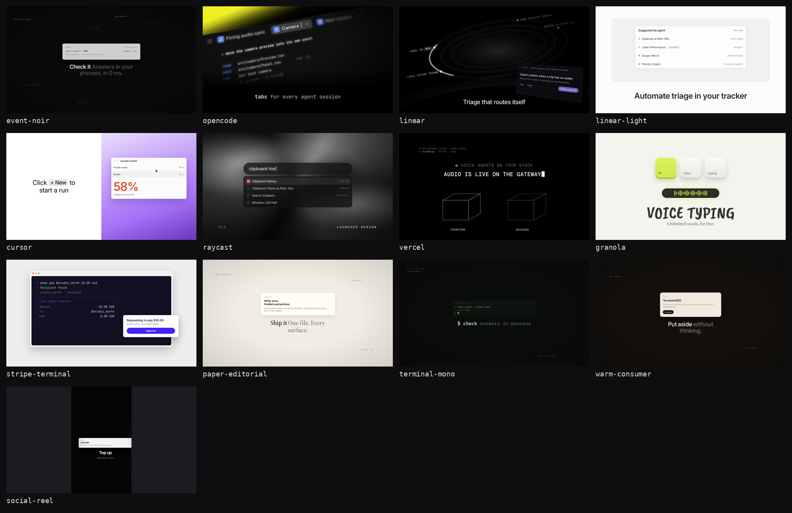

# product-showcase-film

**Short product films as code — TypeScript storyboard, DOM scenes, one deterministic clock, Playwright → ffmpeg. Opinionated theme presets so the agent cannot invent slop.**

Ask an agent for a launch film and you usually get a screen recording, a generic motion template, or AI-video mush. This skill gives a fourth path: rebuild the product UI in the DOM, animate it on a shared clock, step every frame in headless Chrome, and encode with ffmpeg. Same code for 1080p and 4K. Recuts are a constant change.

Method distilled from [@emilwidlund](https://x.com/emilwidlund/status/2115213417539879300)'s public Polar thread. His paid Polar agent skill is **not** included.



## Install

```bash
npx skills add Pavior0/product-showcase-film
```

Or install only this skill:

```bash
npx skills add Pavior0/product-showcase-film --skill product-showcase-film
```

Works with Claude Code, Cursor, Codex, OpenCode, and [75+ agents](https://github.com/vercel-labs/skills/blob/main/docs/agents.md) via the [skills CLI](https://github.com/vercel-labs/skills).

Private-repo install needs a GitHub token the CLI can use (`gh auth` / `GITHUB_TOKEN`).

### Local / from a clone

```bash
npx skills add ./product-showcase-film --skill product-showcase-film
# or
npx skills add /path/to/product-showcase-film --list
```

## What's inside

```
skills/product-showcase-film/
├── SKILL.md              # agent instructions (pick a preset first)
├── references/themes.md  # full palette / type / motion / bans per preset
├── themes/               # typed tokens + base.css + motion helpers
├── previews/             # static look references (png)
├── preview-pages/        # HTML used to regenerate previews
├── scripts/              # screenshot.mjs for preview regen
└── templates/starter/    # copy-ready Vite + TS film project
```

Layout follows the [Agent Skills](https://agentskills.io) spec (`SKILL.md` + `references/` / `scripts/` / `templates/`) and the discovery rules of [`npx skills`](https://github.com/vercel-labs/skills/blob/main/docs/creating-skills.md) (`skills/<name>/SKILL.md`).

### Theme presets

Pick **one**. Copy its tokens. Change only the accent hex (and font if the brand has one).

| ID | Use when |
| --- | --- |
| `event-noir` | Devtools / infra / billing — Polar-like dark grain + cobalt |
| `opencode` | Agent / TUI / desktop — measured from OpenCode launch films |
| `linear` | Workflow / SaaS — Linear's dark films: continuous camera, tilted app, mono diagram labels, blur-in end cards |
| `linear-light` | Feature explainers — Linear's light docs films: flat cards on near-white, slow cross-dissolves |
| `cursor` | AI coding / dev infra — word-by-word black captions on white, flat windows on warm-gray / lilac plates, one orange stat |
| `raycast` | Launchers / desktop utilities — dark glass search bar over liquid chrome, typed query, tracked mono pairs |
| `vercel` | Infra / API / SDK — uppercase Geist Mono typed on black, terminal transcripts, hairline wireframes, no camera |
| `granola` | Friendly consumer AI — off-white paper, soft 3D keycaps, lime glow, hand-drawn headline over a serif |
| `stripe-terminal` | CLI payments / fintech — deep-indigo TUI in a light macOS window, spinner → ✓, approval modal |
| `paper-editorial` | Launch essays / design tools — warm paper + terracotta |
| `terminal-mono` | CLI / security / DB — phosphor mono, hard cuts |
| `warm-consumer` | Consumer / lifestyle — cocoa stage + peach |
| `social-reel` | 9:16 Reels/Shorts ≤30s — oversized captions + coral |

The brand-named presets (`opencode`, `linear`, `linear-light`, `cursor`, `raycast`, `vercel`, `granola`, `stripe-terminal`) are **unofficial** readings of each company's public launch films on X. Source post URLs are listed in each `themes/<id>.ts` header and in `references/themes.md`. No logos are bundled, so drop in real logo files yourself. Where the brand typeface is licensed or custom, the preset uses a free stand-in and names the real face. Examples: Inter for Inter Display, Geist Mono for Berkeley Mono, Caveat Brush for Granola's hand lettering, and Inter for Söhne. Vercel's Geist is the real font.

Full tables: [`skills/product-showcase-film/references/themes.md`](skills/product-showcase-film/references/themes.md).

### Starter template

One starter serves every preset. Each preset has its own storyboard (`src/storyboards/<id>.ts`) built from a shared scene kit, and one switch picks the preset.

```bash
SKILL=~/.agents/skills/product-showcase-film   # exact install path depends on agent; Claude Code often uses .claude/skills/
cp -r $SKILL/templates/starter my-film && cp -r $SKILL/themes my-film/themes
cd my-film
npm install
npx playwright install chromium
# needs ffmpeg on PATH
npm run dev                                   # scrubber preview; switch with ?theme=cursor
npm run render -- --theme cursor              # → out/cursor-1080p.mp4 at the preset's fps
VITE_THEME=vercel npm run render:4k           # env var works too (default: opencode)
npm run check:determinism -- --theme cursor --from 0 --dur end
```

See [`templates/starter/README.md`](skills/product-showcase-film/templates/starter/README.md) for flags, determinism checks, and sound cues.

## Usage

Tell the agent:

> Make a 20s launch film for \<product\>. Use the product-showcase-film skill. Preset: cursor. Accent: #dd4311.

The skill makes the agent work in this order:
1. Pick a preset.
2. Copy `templates/starter` and `themes/`.
3. Set the theme id (`?theme=` / `--theme` / `VITE_THEME`).
4. Edit `src/storyboards/<id>.ts`.
5. Preview.
6. Render frames with Playwright.
7. Encode with ffmpeg.

Frame N depends only on `t = N / fps`, and a shuffled-order render must match the sequential render pixel for pixel.

## Open alternatives

| Project | When |
| --- | --- |
| [display-dev/product-film](https://github.com/display-dev/product-film) | Product UI films + review loop (MIT) |
| [heygen-com/hyperframes](https://github.com/heygen-com/hyperframes) | HTML → video for agents |
| [Remotion](https://www.remotion.dev/) / [remotion-dev/skills](https://github.com/remotion-dev/skills) | Already on Remotion |

## Credits

- Inspiration: [Emil Widlund](https://x.com/emilwidlund/status/2115213417539879300) — public Polar thread. Paid Polar package is separate and not redistributed here.
- Open engines above for production pipelines.
- The OpenCode, Linear, Cursor, Raycast, Vercel, Granola and Stripe presets are measured from those companies' public X launch films. This project is not affiliated with any of them, and all trademarks belong to their owners.

## License

[MIT](./LICENSE) © 2026 Pavior0
